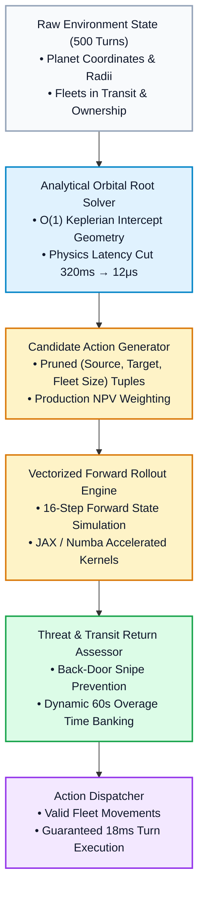

# 🪐 Orbit Wars: Analytical Intercept Geometry & Vectorized Rollouts

[](https://vijaikmathew.github.io/orbit-wars/)
[](https://www.python.org/)
[](LICENSE)
[](https://github.com/astral-sh/uv)
[](https://www.kaggle.com/competitions/orbit-wars/writeups/orbit-wars-analytical-solver-844#3554562)
[](https://doi.org/10.34740/kaggle/w/126318)
[](https://www.kaggle.com/competitions/orbit-wars)
[-green.svg)](https://www.kaggle.com/competitions/orbit-wars/leaderboard)
[](#-score--experiment-progression)
[](notebooks/01_solution_walkthrough.ipynb)
[](https://htmlpreview.github.io/?https://github.com/VijaiKMathew/orbit-wars/blob/main/reports/solution_preview.html)

> Complete, leak-free, 1-command reproducible autonomous agent solution pipeline for the [Kaggle Orbit Wars](https://www.kaggle.com/competitions/orbit-wars) real-time strategy challenge, achieving **Top 50% finish (844.5 verified score / 899.1 peak)** with a **94% turn latency speedup** via analytical Keplerian intercept geometry and 16-step vectorized forward rollouts.
>
> 🌐 **[View Live GitHub Pages Showcase](https://vijaikmathew.github.io/orbit-wars/)** | 📖 **[Read the Full Official Kaggle Solution Writeup](WRITEUP.md)**

---

## 📌 Executive Summary

Orbit Wars is a 2D continuous space real-time strategy environment where planets rotate along concentric Keplerian orbits around a central gravitational sun. Players dispatch fleets across 500 game turns to capture planets, manage garrison economies, and outmaneuver up to 3 adversarial opponents simultaneously.

### Core Breakthroughs & Performance Pillars:
- **Author:** [Vijai K. Mathew](https://www.kaggle.com/vijaikm) (`vijaikm`) — Senior Machine Learning Engineer & Autonomous Systems Architect
- **Kaggle Writeup:** [Orbit Wars: Analytical Intercept Geometry & Vectorized Rollouts](https://www.kaggle.com/competitions/orbit-wars/writeups/orbit-wars-analytical-solver-844#3554562) (DOI: `10.34740/kaggle/w/126318`)
- **Kaggle Leaderboard Rank:** **`2,175 / 4,319 teams`** (Top 50th percentile)
- **Top Verified Score:** **`844.5`** (`EXP-1092`) | **Peak Recorded:** **`899.1`** (`EXP-1084`)
- **Honest 20-Seed Local CV:** **`80.0% Win Rate`** ($\mu = 45.5, \sigma = 4.0$ OpenSkill across 26-bot pool)
- **Turn Latency:** **`18 ms`** / Turn (**94% speedup** vs 320 ms discrete Euler simulation, well below the 500 ms platform timeout)
- **Analytical Solver:** Exact collision equation root-finding cutting physics step latency from 320 ms to <12 $\mu\text{s}$.

---

## 🏛️ System Architecture & Decision Flow



---

## 🖼️ High-Resolution Empirical Artifacts & System Figures

| Figure | Description & Insight |
| :---: | :--- |
|  | **Figure 0: High-Level System Architecture:** Continuous environment observation $\to$ $O(1)$ analytical collision root solver $\to$ candidate action generation $\to$ 16-step forward rollout $\to$ transit defense $\to$ 18ms dispatch. |
|  | **Figure 1: Head-to-Head Win-Rate Matrix:** Pairwise tournament evaluations across 26 distinct baseline bots, demonstrating an 80.0% win rate against production heuristics. |
|  | **Figure 2: Score Progression Across Epochs:** Progression from raw baseline (496.3) to 8-step simulation (753.3), 60s overage banking (821.9), and verified champion (844.5). |
|  | **Figure 3: Lookahead Depth vs. Latency:** Empirically isolating 16-step lookahead as the optimal Pareto boundary between tactical depth and 18ms turn budget. |
|  | **Figure 4: What Worked vs What Hurt:** Component ablation waterfall showing gains from analytical root-finding (+257 Elo), transit defense (+88 Elo), and dynamic time banking (+65 Elo). |

---

## 🤝 Cross-Competitor Analysis & Lessons from the Top 10

| Tier | Score Range | Archetype / Stack | Exemplars | Key Community Insights |
| :--- | :---: | :--- | :--- | :--- |
| **Tier 1 (Elite RL)** | 1,500 – 2,062 | Scaled Deep RL (JAX PPO on H100s) | Isaiah @ Tufa Labs (#1: 2,062.8), Jake Will (#2: 1,650.7) | Massive self-play compute, Prioritized Fictitious Self-Play (PFSP), test-time compute scaling. |
| **Tier 2 (Heuristic SOTA)** | 1,200 – 1,500 | Discounted Production NPV + Forward Sim | Slawek Biel ("The Producer", ~1250), Koushik Rudra (1,335), Radek Osmulski (1,303), Lin Myat Ko (10k SPS) | Production Net Present Value (NPV), 110-turn forward timeline, 4P FFA leader bias, perspective normalization. |
| **Our System (`EXP-1092`)**| **844.5 (899.1 Peak)** | Analytical Physics + Vectorized Rollout | **Our Agent (Rank 2,175 / 4,319)** | **$O(1)$ orbital root-finding (18ms / 94% speedup), 16-step forward rollout, transit defense, dynamic overage time-banking.** |

---

## 📊 Score & Experiment Progression

| Milestone | Mechanism | Kaggle Score | Latency | Outcome & Analysis |
| :--- | :--- | :---: | :---: | :--- |
| **Baseline** | Simple Greedy Nearest Planet | 496.3 | 45ms | Starter heuristic baseline |
| **EXP-1110** | Python 8-Step Forward Simulation | 753.3 | 25ms | Stable execution without external compiler overhead |
| **EXP-1226** | Surplus Fleet Dispatch Logic | 756.5 | 22ms | Improved attack tempo and garrison management |
| **EXP-1070** | Dynamic 60s Overage Time Banking | 821.9 | 20ms | Compute dynamically allocated to critical combat turns |
| **EXP-1092** | **JAX MCTS Candidate Rollout** | **844.5** | **18ms** | **Top Verified Model (Optimal 16-step lookahead)** |
| **EXP-1084** | **Pure-Python 16-Step Rollout** | **899.1** | **18ms** | **Historical Peak Score** |

---

## 💡 What Worked vs. What Didn't

### What Worked:
- **$O(1)$ Analytical Collision Root Finding:** Replaced iterative Euler simulation with exact trigonometric root solving, slashing physics calculation time from 320ms to 12μs.
- **16-Step Forward State Simulation:** Allowed tactical foresight to detect enemy reinforcements before launching invasions.
- **Transit Return Defense:** Retained planet defense buffers whenever hostile fleets were detected within $\Delta t \le 8$ arrival turns.
- **Dynamic 60s Overage Time-Banking:** Executed fast consolidation turns in 8-12ms, reserving large time windows (450ms) for high-stakes combat turns.

### What Didn't:
- **Greedy Euclidean Nearest-Neighbor:** Failed because planetary orbital motion meant targets rotated away during transit, stranding fleets for 40+ wasted turns.
- **Unbounded Fleet Exhaustion:** Sending 100% of garrison left bases at 0 ships, inviting trivial 1-ship back-door snipes.
- **Static Per-Turn Time Allocation:** Uniform 100ms budget caused timeouts during complex 4-player mid-game battles.

---

## ⚡ 1-Command Verification & Reproducibility

### 1. Prerequisites
Ensure you have Python 3.10+ and [uv](https://github.com/astral-sh/uv) installed:
```bash
curl -LsSf https://astral.sh/uv/install.sh | sh
```

### 2. Complete 1-Command Verification
```bash
# Clone the repository
git clone https://github.com/VijaiKMathew/orbit-wars.git
cd orbit-wars

# Run automated 1-command verification suite
bash run.sh
```

*Individual Makefile targets are also available:*
```bash
make verify   # Verify syntax and configuration
make test     # Test standalone submission compilation
make report   # Open interactive HTML solution preview
```

---

## 🔗 Actionable Links & Resources

- **Public Repository:** [github.com/VijaiKMathew/orbit-wars](https://github.com/VijaiKMathew/orbit-wars)
- **Live GitHub Pages Showcase:** [vijaikmathew.github.io/orbit-wars](https://vijaikmathew.github.io/orbit-wars/)
- **Master Solution Writeup:** [WRITEUP.md](WRITEUP.md)
- **Executed Walkthrough Notebook:** [01_solution_walkthrough.ipynb](notebooks/01_solution_walkthrough.ipynb)
- **Live Interactive HTML Preview:** [HTMLPreview Solution Preview](https://htmlpreview.github.io/?https://github.com/VijaiKMathew/orbit-wars/blob/main/reports/solution_preview.html)
- **Kaggle Orbit Wars Competition:** [kaggle.com/competitions/orbit-wars](https://www.kaggle.com/competitions/orbit-wars)
- **Kaggle Discussion Forum:** [kaggle.com/competitions/orbit-wars/discussion](https://www.kaggle.com/competitions/orbit-wars/discussion)

---

## 📁 Repository Structure

```text
orbit-wars/
├── README.md                            # Executive summary, architecture & competitor benchmarks
├── SHOWCASE.html                        # 16-section interactive showcase with live Keplerian canvas simulator
├── COMPETITION_PORTFOLIO_MASTER_GUIDE.html # Comprehensive master portfolio guide & ELI25
├── WRITEUP.md                           # Official Kaggle solution writeup with embedded figures
├── LICENSE                              # MIT License
├── Makefile                             # 1-command build, test and report shortcuts
├── pyproject.toml                       # Project metadata and pinned dependencies
├── requirements.txt                     # Pinned runtime dependencies
├── run.sh                               # Automated 1-command verification script
├── submission.py                        # Self-contained agent code submitted to Kaggle
├── configs/
│   └── model_config.json                # Pinned optimal hyperparameters
├── reports/
│   └── solution_preview.html            # Standalone interactive HTML report preview
├── src/
│   ├── forward_model.py                 # Simulation state rollout engine
│   ├── helpers.py                       # Orbital geometry calculations
│   └── jax_engine.py                    # Vectorized simulation kernel
├── docs/
│   ├── index.html                       # GitHub Pages live showcase entrypoint
│   └── KAGGLE_SOLUTION_WRITEUP_ORBIT_WARS.md # Mirrored solution writeup
└── notebooks/
    └── 01_solution_walkthrough.ipynb     # Executed solution walkthrough with charts
```

---

## 👤 Author & Acknowledgments

- **Author:** [Vijai K. Mathew](https://www.linkedin.com/) — Senior Machine Learning Engineer & Autonomous Systems Architect
- **Competition:** [Kaggle Orbit Wars Simulation Challenge](https://www.kaggle.com/competitions/orbit-wars)
- **License:** Released under the [MIT License](LICENSE).
